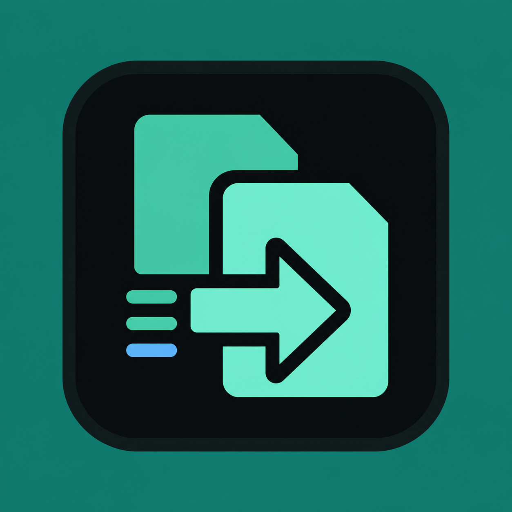

# RobustCopy

<p align="center">
  
</p>

A native Windows interface for `robocopy.exe`, built with .NET 10 WPF. It keeps Robocopy's reliability while adding safe option selection, descriptive help, pre-scan totals, live progress, Pause/Resume/Stop controls, command preview, and persistent logs.

The interface design references are kept in [`docs/mockups`](docs/mockups/README.md).

## Download

The current release is **RobustCopy 1.0.2**, published by **Kaleb Creative Studio** for Windows 10 and Windows 11 x64.

- [Download RobustCopy.exe](https://github.com/tnoahc/RobustCopy/releases/download/v1.0.2/RobustCopy.exe)
- [Download the SHA-256 checksum](https://github.com/tnoahc/RobustCopy/releases/download/v1.0.2/RobustCopy.exe.sha256)
- [View the GitHub release](https://github.com/tnoahc/RobustCopy/releases/tag/v1.0.2)
- [Browse the GitHub repository](https://github.com/tnoahc/RobustCopy)
- [Read the privacy policy](PRIVACY.md)

The 62.1 MB executable is self-contained; no separate .NET installation is required. Each release publishes its SHA-256 checksum as `RobustCopy.exe.sha256` next to the executable. To verify a download, compare it with:

```powershell
Get-FileHash .\RobustCopy.exe -Algorithm SHA256
```

### What's new in 1.0.2

**Safety**

- Destructive switches (`/MIR`, `/PURGE`, `/MOV`, `/MOVE`) can no longer bypass the confirmation prompt when typed with a `-` prefix, in the file-pattern field, or in the exclude lists.
- Pressing Stop while a job is starting now reliably prevents Robocopy from launching.
- A Robocopy process that is terminated unexpectedly is reported as a failure instead of a success.
- Move-only jobs no longer claim that destination items will be deleted.

**Reliability**

- Unexpected errors write a crash report to the log folder instead of closing the app silently.
- File names with non-ASCII characters are decoded with the system OEM code page, so they display correctly.
- Copy log works with very large and still-running transcripts (the last 5 MB is copied).
- Open log and Copy log are available after a failed or declined pre-scan.
- Low free-space mode values are checked before a run starts.
- Copied command previews keep paths that end in a backslash intact.

**Performance and usability**

- Transcripts no longer contain a line for every progress percentage, and the live view updates smoothly during large transfers.
- Selecting an option now turns off options it conflicts with instead of being blocked; for example, Mirror is selectable straight away.
- Logs older than 90 days are removed automatically at startup.

## Features

- Choose local, mapped-drive, and UNC source/destination folders through the Windows folder picker.
- Swap source and destination in one click.
- Select Robocopy switches from categorized, two-column strategy cards with descriptions; selecting an option turns off any option it conflicts with.
- Enter additional supported switches in the Advanced field.
- Preview the exact command while configuring a job.
- Pre-scan safely with `/L` for planned files, bytes, and destination deletions.
- Show overall/current-file progress, transfer speed, ETA, file counts, and live output.
- Pause and resume the live Robocopy process, or stop it permanently.
- Require confirmation for Mirror, Purge, and Move modes.
- Save UTF-8 run transcripts under `%LocalAppData%\RobustCopy\Logs`; logs older than 90 days are removed automatically at startup.
- Preserve logs from earlier installations by copying them into the RobustCopy log directory on first use.
- Write a crash report to the log directory if the app hits an unexpected error.
- Run Robocopy without `cmd.exe`; paths and switches are passed through `ProcessStartInfo.ArgumentList`.

Robocopy console output is decoded using the system OEM code page (the one Robocopy writes in, which follows the Windows system locale) and then written as UTF-8. The GUI reserves `/UNICODE` because the installed Robocopy build emits a mixed BOM/console stream for that switch when stdout is redirected, which cannot be parsed reliably for live progress.

## Interface

The application uses a dark console-inspired three-panel layout:

- **Transfer locations** contains the source, destination, file pattern, and command preview.
- **Transfer strategy** provides scrollable option cards using the original Folders, Reliability, Metadata, Filters, Performance, and Destructive Operations groups.
- **Live transfer overview** shows progress, current-file details, transfer metrics, and the saved run transcript.

The Start, Pause, Resume, and Stop controls remain visible in the header, alongside safety guidance and the current run state. The interactive HTML source and rendered visual reference are documented in [`docs/mockups`](docs/mockups/README.md).

## Requirements

- Windows 10 or Windows 11, x64.
- The .NET 10 SDK is required only to build from source.
- The published self-contained executable does not require a separately installed .NET runtime.

## Build and run

Open PowerShell in this repository:

```powershell
dotnet build RobustCopy.slnx --configuration Release
dotnet run --project src\RobustCopy\RobustCopy.csproj
```

If an installer has just added the SDK and the current terminal has not refreshed its `PATH`, start a new PowerShell window or invoke `C:\Program Files\dotnet\dotnet.exe` directly.

## Tests

The repository uses a dependency-free executable test project so it can be verified without downloading a test framework. It covers command construction, validation, parsing, exit codes, and safe Robocopy integration in temporary folders, including Pause/Resume and Stop/Restart.

```powershell
dotnet run --project tests\RobustCopy.Tests\RobustCopy.Tests.csproj --configuration Release
```

## Publish a portable executable

```powershell
dotnet publish src\RobustCopy\RobustCopy.csproj `
  --configuration Release `
  --runtime win-x64 `
  --self-contained true `
  --output artifacts\publish
```

The main deliverable is `artifacts\publish\RobustCopy.exe`.

The `artifacts/` directory contains generated build outputs and visual verification files and is intentionally excluded from version control. Run the publish command whenever the distributable executable needs to be refreshed.

## Continuous integration

The GitLab pipeline in [`.gitlab-ci.yml`](.gitlab-ci.yml) runs on merge requests, the default branch, and tags:

- **build** runs `dotnet build RobustCopy.slnx --configuration Release`.
- **test** runs the test project above; any failing test fails the job.
- **release** runs on version tags only (`v1.2.3`), after the tests pass, using [`ci/release.ps1`](ci/release.ps1):
  1. Builds the self-contained `RobustCopy.exe` and writes `RobustCopy.exe.sha256` in the checksum format shown above.
  2. Pushes the tag to GitHub and creates the GitHub release `RobustCopy <version>` with `RobustCopy.exe`, `RobustCopy.exe.sha256`, and `RobustCopy.pdb`. The release is created as a draft and published only after every file has uploaded. Its notes come from the README's "What's new in <version>" section, followed by the checksum.
  3. Creates the GitLab release with the same notes and download links that point to the GitHub files. The executable is not uploaded to GitLab, because the GitLab instance's proxy cannot accept uploads that large.

  The job fails with a clear message if a release for the tag already exists, or if an upload fails (the GitHub release is then left as a draft).

The jobs need a Windows runner using the shell executor with PowerShell, because WPF and the Robocopy integration tests cannot run in Docker and require a real `C:\Windows\System32\robocopy.exe`. The .NET 10 SDK is expected to be preinstalled on the runner; a commented-out `dotnet-install.ps1` fallback is kept in `.gitlab-ci.yml` for runners without it. Jobs select the runner by the `windows` tag, which is set once under `default: tags:`.

Releasing requires a `GITHUB_TOKEN` CI variable that is masked and protected: a fine-grained GitHub token with **Contents: read and write** on `tnoahc/RobustCopy`. Version tags (`v*`) must be protected so that tag pipelines can read it.

To release a new version: bump `<Version>` in `src/RobustCopy/RobustCopy.csproj` and the version in `src/RobustCopy/app.manifest`, update the version and links in this README's Download section and add a "What's new in <version>" section, merge, then tag the merge commit (for example `git tag -a v1.0.3 -m "RobustCopy 1.0.3"`) and push the tag to GitLab.

## Safety notes

- `/MIR` and `/PURGE` may delete destination content.
- `/MOV` and `/MOVE` delete successfully copied source content.
- The GUI performs a list-only pre-scan and shows a mandatory confirmation before these operations.
- Source and destination cannot be the same folder or contain one another.
- Backup modes may require Windows privileges that the current account does not have; the app does not auto-elevate.
- Stop terminates the current Robocopy process. Restartable mode (`/Z`) is enabled by default, so a later run can continue supported partial transfers.
